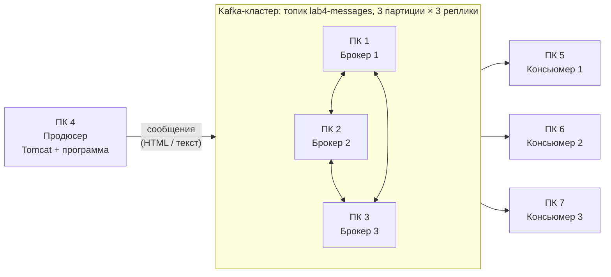

# Доп к ЛР4: Apache Kafka на 7 компьютерах

Гайд от и до: как семерым людям поднять систему «1 продюсер → 3 брокера → 3 консьюмера», в которой у всех одна и та же программа (ЛР4 + Kafka), а продюсер рассылает консьюмерам HTML или обычные сообщения.

Репозиторий: <https://github.com/YuryHich/AiPRP_lab4>

- ветка `main` — ЛР4 как есть: REST TimeService, калькулятор по варианту 1, веб-сокет-чат;
- ветка `kafka-dop` — то же самое плюс Kafka. Всё из этого гайда лежит в ней;
- ветки `variant2` и `kafka-dop-variant2` — то же, но с переводом по варианту 2 вместо калькулятора. Kafka-часть в них такая же, гайд подходит к обеим.

Пароли и ключи здесь не нужны: Kafka работает без авторизации (PLAINTEXT), потому что это учебная локальная сеть. Всё работает «из коробки».

---

## Содержание

0. [Коротко: что делает каждый](#0-коротко-что-делает-каждый)
1. [Роли семи компьютеров](#1-роли-семи-компьютеров)
2. [Подготовка дома: Git, Docker Desktop, репозиторий](#2-подготовка-дома-git-docker-desktop-репозиторий)
3. [Общая сеть: раздача с телефона или роутер](#3-общая-сеть-раздача-с-телефона-или-роутер)
4. [Брандмауэр Windows и профиль сети](#4-брандмауэр-windows-и-профиль-сети)
5. [Брокеры (компьютеры 1–3)](#5-брокеры-компьютеры-13)
6. [Продюсер (компьютер 4)](#6-продюсер-компьютер-4)
7. [Консьюмеры (компьютеры 5–7)](#7-консьюмеры-компьютеры-57)
8. [Эксперименты для защиты](#8-эксперименты-для-защиты)
9. [Запуск без Docker](#9-запуск-без-docker)
10. [Типичные ошибки и что делать](#10-типичные-ошибки-и-что-делать)
11. [Теория: что происходит внутри](#11-теория-что-происходит-внутри)
12. [Как всё выключить](#12-как-всё-выключить)

---

## 0. Коротко: что делает каждый

**Дома, все семеро:**

1. Установить Git и Docker Desktop (раздел 2).
2. Выполнить `git clone -b kafka-dop https://github.com/YuryHich/AiPRP_lab4.git`.
3. Запустить `scripts\prepare.cmd`: он скачает около 1 ГБ образов.
4. По желанию прогнать всю систему на одном компьютере: `cd local` → `docker compose up -d`.

**На занятии:**

1. Все подключаются к одной точке доступа.
2. Каждый запускает `scripts\my-ip.cmd`; IP записываются в общую табличку.
3. Все запускают `scripts\open-firewall.cmd` от имени администратора и выключают VPN.
4. **Брокеры 1, 2, 3:** `kafka\broker\setup-broker.cmd` → `docker compose up -d`. Затем брокер 1 запускает `create-topic.cmd`.
5. **Консьюмеры:** `app\setup-app.cmd` (роль `consumer`) → `docker compose up -d`. Затем открыть `http://localhost:8079/TimeService/kafka/consumer.html`.
6. **Продюсер:** `app\setup-app.cmd` (роль `producer`) → `docker compose up -d`. Затем открыть `http://localhost:8079/TimeService/kafka/producer.html` и нажать «Отправить в Kafka».
7. Сообщение появляется у всех трёх консьюмеров.

Ниже каждый шаг расписан подробно.

---

## 1. Роли семи компьютеров



| ПК | Роль | Что запускает | Настройка |
|----|------|---------------|-----------|
| 1 | Брокер 1 | `kafka/broker` | `NODE_ID=1` |
| 2 | Брокер 2 | `kafka/broker` | `NODE_ID=2` |
| 3 | Брокер 3 | `kafka/broker` | `NODE_ID=3` |
| 4 | Продюсер | `app` | `ROLE=producer`, `NODE_NAME=producer` |
| 5 | Консьюмер 1 | `app` | `ROLE=consumer`, `NODE_NAME=consumer1` |
| 6 | Консьюмер 2 | `app` | `ROLE=consumer`, `NODE_NAME=consumer2` |
| 7 | Консьюмер 3 | `app` | `ROLE=consumer`, `NODE_NAME=consumer3` |

Как устроены роли:

- **Программа у всех одна** — ЛР4 + Kafka, образ `aiprp-lab4-timeservice`. Чем она будет, продюсером или консьюмером, решает переменная `ROLE` в файле `app\.env`. Старые адреса ЛР4 (`/api/time`, страница `/calc.html` с полем ввода, `/api/calc`, чат) работают на всех узлах.
- **Брокер** — это не наша программа, а сервер Apache Kafka в Docker-контейнере `apache/kafka:3.9.0`. Каждый брокер одновременно и **контроллер** кластера (режим KRaft, без ZooKeeper).
- Брокеру своя программа не нужна, но запустить её на том же ПК можно. Например, если людей меньше семи, брокер 1 может быть ещё и продюсером. Для задания лучше честно 7 разных компьютеров.

Распределите роли заранее. Решите, кто брокеры: это самые надёжные ноутбуки, с зарядкой и не засыпающие.

---

## 2. Подготовка дома: Git, Docker Desktop, репозиторий

Делать **дома** с нормальным интернетом. Через раздачу с телефона качать около 1 ГБ на семь человек долго и дорого.

### 2.1. Git

1. Скачать: <https://git-scm.com/download/win>.
2. Установить, везде нажимая Next.
3. Проверить в PowerShell или cmd: `git --version`.

### 2.2. Docker Desktop

1. Требования: Windows 10/11 64-bit, включённая виртуализация. Проверить её можно в «Диспетчер задач → Производительность → ЦП → Виртуализация: Включено». Если выключена, включите Intel VT-x / AMD-V (SVM) в BIOS.
2. Скачать: <https://www.docker.com/products/docker-desktop/>.
3. Запустить установщик, оставить галочку **Use WSL 2 instead of Hyper-V**.
   - Чтобы не ставить на диск C, установщик можно запустить из cmd от администратора:
     `"Docker Desktop Installer.exe" install --installation-dir=D:\Docker`
   - После установки образы тоже можно перенести на D: Docker Desktop → Settings → Resources → Advanced → Disk image location.
4. Перезагрузить компьютер, если попросит.
5. Запустить Docker Desktop и дождаться зелёной надписи **Engine running** внизу слева. Регистрироваться не обязательно, можно нажать Skip.
6. Если просит обновить WSL, выполните в PowerShell от администратора `wsl --update`.
7. Проверка:

   ```cmd
   docker version
   docker compose version
   ```

### 2.3. Склонировать репозиторий

Удобнее всего на диск D:

```cmd
cd /d D:\
git clone -b kafka-dop https://github.com/YuryHich/AiPRP_lab4.git
cd AiPRP_lab4
```

Если репозиторий уже склонирован на ветке `main`:

```cmd
git fetch
git checkout kafka-dop
git pull
```

Без Git: на GitHub выберите ветку `kafka-dop` → Code → Download ZIP и распакуйте.

Структура ветки `kafka-dop`:

```
AiPRP_lab4/
├── KAFKA_DOP_ГАЙД.md          ← этот файл
├── TimeService/               ← программа ЛР4 + Kafka (Maven, Tomcat 9)
│   ├── Dockerfile             ← сборка образа программы
│   └── src/main/...
│       ├── java/com/example/kafka/   ← KafkaConfig, KafkaSender, KafkaConsumerListener, MessageStore
│       ├── java/com/example/service/KafkaResource.java  ← REST /api/kafka/*
│       └── webapp/kafka/      ← producer.html, consumer.html
├── kafka/broker/              ← брокер Kafka для ПК 1–3
│   ├── docker-compose.yml
│   ├── .env.example
│   ├── setup-broker.cmd       ← спрашивает номер и IP, пишет .env
│   ├── create-topic.cmd       ← создать топик (на одном брокере)
│   └── status.cmd             ← состояние кластера
├── app/                       ← программа для ПК 4–7
│   ├── docker-compose.yml
│   ├── .env.example
│   └── setup-app.cmd          ← спрашивает роль и IP брокеров, пишет .env
├── local/docker-compose.yml   ← вся система на одном ПК (тренировка)
├── samples/hello.html         ← пример HTML-сообщения
└── scripts/
    ├── prepare.cmd            ← скачать всё заранее
    ├── my-ip.cmd              ← узнать свой IP
    ├── open-firewall.cmd      ← открыть порты (от администратора)
    └── check-brokers.cmd      ← проверить, видны ли брокеры
```

### 2.4. Скачать образы заранее

Двойной щелчок по `scripts\prepare.cmd` или из cmd:

```cmd
scripts\prepare.cmd
```

Скрипт делает две вещи:

- `docker pull apache/kafka:3.9.0` — образ Kafka, около 400 МБ;
- `docker build -t aiprp-lab4-timeservice TimeService` — собирает программу внутри контейнера Maven и кладёт WAR в Tomcat 9. Скачается около 600 МБ: Maven, JDK 17, Tomcat и зависимости. Ставить Maven и JDK на сам компьютер не нужно.

Если на занятии будет кто-то без подготовки, образы можно перенести на флешке:

```cmd
docker save -o D:\lab4-images.tar apache/kafka:3.9.0 aiprp-lab4-timeservice
rem на другом компьютере:
docker load -i E:\lab4-images.tar
```

### 2.5. Тренировка: вся система на одном компьютере

Перед занятием стоит убедиться, что всё работает. Каждый может поднять у себя полный стенд из 7 узлов:

```cmd
cd local
docker compose up -d
docker compose ps
```

Подождите 20–30 секунд и откройте:

- продюсер: <http://localhost:8090/TimeService/kafka/producer.html>
- консьюмер 1: <http://localhost:8091/TimeService/kafka/consumer.html>
- консьюмер 2: <http://localhost:8092/TimeService/kafka/consumer.html>
- консьюмер 3: <http://localhost:8093/TimeService/kafka/consumer.html>

Нажмите «Отправить в Kafka» у продюсера: сообщение появится на всех трёх страницах консьюмеров.

Остановить стенд:

```cmd
docker compose down
```

---

## 3. Общая сеть: раздача с телефона или роутер

Kafka-брокеры, продюсер и консьюмеры обмениваются данными напрямую по IP. Поэтому все 7 компьютеров должны быть **в одной локальной сети** и **видеть друг друга**. Интернет при этом не нужен, если образы скачаны заранее.

### 3.1. Вариант А: раздача Wi-Fi с Android-телефона (рекомендуется)

1. На телефоне откройте Настройки → Подключения (или Сеть и интернет) → **Точка доступа и модем** → **Мобильная точка доступа**.
2. Задайте имя сети, например `kafka-lab`, и простой пароль, например `kafka12345`.
3. **Диапазон:** выберите **2,4 ГГц**. Его видят все ноутбуки, в том числе старые; 5 ГГц видят не все.
4. **Максимум подключений:** найдите в настройках точки доступа «Максимальное число подключений» и поставьте не меньше 7. На Samsung по умолчанию 10, но на некоторых телефонах лимит 5 — тогда двое не подключатся.
5. Включите точку доступа, и все 7 ноутбуков подключаются к `kafka-lab`.
6. Мобильные данные можно выключить: Kafka ходит только внутри сети. Интернет нужен только если образы не скачаны.

Android-раздача обычно назначает адреса вида `192.168.43.x`, `192.168.x.x` или `10.x.x.x`.

### 3.2. Вариант Б: iPhone

На iPhone: Настройки → Режим модема → «Разрешать другим», плюс включить **«Максимальная совместимость»**, чтобы был 2,4 ГГц.

Ограничения:

- iPhone раздаёт адреса `172.20.10.x` из маленькой подсети, и одновременно держит обычно около 5 устройств по Wi-Fi. **На 7 ноутбуков iPhone, скорее всего, не хватит.**
- Используйте Android или вариант В.

### 3.3. Вариант В: обычный Wi-Fi-роутер

Любой домашний роутер, даже без интернета: включить в розетку и подключить все 7 ноутбуков к его Wi-Fi. Это самый надёжный вариант, лимитов на устройства фактически нет.

### 3.4. Вариант Г: хот-спот Windows на одном из ноутбуков

Ноутбук, на котором хот-спот включён, сам тоже участвует в системе, например как продюсер.

1. Откройте Параметры → Сеть и Интернет → **Мобильный хот-спот**.
2. Включите его и задайте имя и пароль в «Свойствах». Диапазон — 2,4 ГГц.
3. Остальные 6 ноутбуков подключаются к этой сети. Лимит Windows — 8 клиентов, этого хватает.
4. Адреса будут вида `192.168.137.x`; у ноутбука-хот-спота адрес `192.168.137.1`.

Нюанс: хот-спот Windows требует, чтобы сам ноутбук был подключён к какой-то сети. Иногда помогает подключить его к телефону по USB-модему.

### 3.5. Сеть университета (eduroam и т. п.) — скорее всего НЕ подойдёт

В публичных Wi-Fi-сетях почти всегда включена **изоляция клиентов**: устройства выходят в интернет, но друг друга не видят. Kafka в такой сети не заработает. Используйте свою точку доступа.

Изоляция клиентов есть и в настройках некоторых роутеров и телефонов: «AP Isolation», «Изоляция точки доступа», «Client isolation». Она должна быть **выключена**.

### 3.6. Выключите VPN

На всех компьютерах **выключите VPN**: Proton, Outline, корпоративный, «france» и т. п. VPN перехватывает сетевой трафик и DNS, из-за чего компьютеры перестают видеть друг друга, а Docker теряет доступ к сети.

### 3.7. Узнайте IP каждого компьютера и заполните табличку

На каждом компьютере выполните:

```cmd
scripts\my-ip.cmd
```

или вручную:

```cmd
ipconfig
```

Нужен **IPv4-адрес адаптера «Беспроводная сеть» (Wi-Fi)**.

**Не подходят:**

- `vEthernet (WSL ...)` — это виртуальный адаптер Docker/WSL, обычно `172.x.x.x`;
- `127.0.0.1`;
- `169.254.x.x` — это значит, что компьютер не получил адрес;
- адаптер VPN.

Запишите все адреса в общую табличку, например на доске или в общем чате:

| ПК | Роль | Имя | IP (пример) | IP (ваш) |
|----|------|-----|-------------|----------|
| 1 | Брокер 1 | NODE_ID=1 | 192.168.43.11 | |
| 2 | Брокер 2 | NODE_ID=2 | 192.168.43.12 | |
| 3 | Брокер 3 | NODE_ID=3 | 192.168.43.13 | |
| 4 | Продюсер | producer | 192.168.43.20 | |
| 5 | Консьюмер 1 | consumer1 | 192.168.43.21 | |
| 6 | Консьюмер 2 | consumer2 | 192.168.43.22 | |
| 7 | Консьюмер 3 | consumer3 | 192.168.43.23 | |

**Самое важное — IP трёх брокеров.** Их знают и вписывают в `.env` все семеро.

Если брокер переподключится к Wi-Fi, его IP может смениться. Тогда придётся поправить `.env` у всех и перезапустить контейнеры. Поэтому брокерам **нельзя** выключать Wi-Fi и отправлять ноутбук в сон. Отключите сон в Панели управления → Электропитание → Настройка перехода в спящий режим → «Никогда», когда ноутбук работает от сети.

---

## 4. Брандмауэр Windows и профиль сети

Брокеры должны принимать входящие подключения:

- на порт **9092** — клиенты (продюсер, консьюмеры) и другие брокеры (репликация);
- на порт **9093** — голосование контроллеров KRaft.

Программа (Tomcat) слушает порт **8079**. Его нужно открыть, только если хотите открывать страницу продюсера или консьюмера с чужого компьютера.

### 4.1. Скрипт: делает всё сам

На **каждом** компьютере: правой кнопкой по `scripts\open-firewall.cmd` → **Запуск от имени администратора**.

Скрипт:

1. добавляет правила брандмауэра «AiPRP lab4 Tomcat 8079» и «AiPRP lab4 Kafka 9092-9093»;
2. переводит текущие сети из профиля «Общедоступная» в **«Частная»**. Windows помечает новую сеть, особенно хот-спот телефона, как общедоступную и режет входящие подключения.

### 4.2. Вручную (если скрипт не сработал)

1. Профиль сети: Параметры → Сеть и Интернет → Wi-Fi → нажать на свою сеть → **Тип сетевого профиля: Частная**.
2. Порты: Панель управления → Брандмауэр Защитника Windows → Дополнительные параметры → Правила для входящих подключений → Создать правило → **Для порта** → TCP, `9092,9093,8079` → Разрешить подключение → отметить все профили → имя `kafka-lab`.
3. При первом запуске Docker Windows может спросить «Разрешить доступ Docker Desktop Backend?». Отметьте **частные сети** и нажмите «Разрешить».

### 4.3. Сторонние антивирусы

У Kaspersky, ESET, Avast, Dr.Web свой сетевой экран, и правила Windows для него ничего не значат. Либо добавьте порты 9092, 9093, 8079 в исключения, либо временно отключите сетевой экран антивируса на время лабы.

### 4.4. Про ping

Windows по умолчанию **не отвечает на ping**: правило ICMP выключено. Поэтому «ping не проходит» ещё не значит, что сеть не работает. Проверяйте порты скриптом `scripts\check-brokers.cmd` (раздел 5.6).

---

## 5. Брокеры (компьютеры 1–3)

Все три брокера делают одно и то же; отличается только `NODE_ID` и `MY_IP`.

### 5.1. Запустить Docker Desktop

Docker Desktop должен быть запущен, внизу слева — Engine running.

### 5.2. Создать файл настроек `.env`

**Способ 1 — скриптом.** Запустите `kafka\broker\setup-broker.cmd` и ответьте на вопросы:

```
Номер брокера (1, 2 или 3): 1
IP этого компьютера: 192.168.43.11
IP брокера 1: 192.168.43.11
IP брокера 2: 192.168.43.12
IP брокера 3: 192.168.43.13
```

**Способ 2 — вручную.** Скопируйте `kafka\broker\.env.example` в `kafka\broker\.env` и отредактируйте в Блокноте:

```ini
NODE_ID=1
MY_IP=192.168.43.11
BROKER1_IP=192.168.43.11
BROKER2_IP=192.168.43.12
BROKER3_IP=192.168.43.13
```

Проверьте:

- `NODE_ID` у каждого брокера **свой**: 1, 2 или 3;
- `MY_IP` — адрес **этого** компьютера; у брокера 1 он равен `BROKER1_IP`, у брокера 2 — `BROKER2_IP` и т. д.;
- строки `BROKER1_IP`, `BROKER2_IP`, `BROKER3_IP` **одинаковые у всех трёх брокеров**;
- файл называется именно `.env`, а не `.env.txt`. В Проводнике включите «Вид → Расширения имён файлов».

Что за параметры в `kafka/broker/docker-compose.yml`:

| Параметр | Значение | Зачем |
|----------|----------|-------|
| `CLUSTER_ID` | `MkU3OEVBNTcwNTJENDM2Qk` | общий ID кластера; одинаковый у всех, иначе брокеры не объединятся |
| `KAFKA_NODE_ID` | из `NODE_ID` | номер узла в кластере |
| `KAFKA_PROCESS_ROLES` | `broker,controller` | узел одновременно хранит данные и голосует за метаданные |
| `KAFKA_LISTENERS` | `PLAINTEXT://:9092,CONTROLLER://:9093` | на каких портах слушать внутри контейнера |
| `KAFKA_ADVERTISED_LISTENERS` | `PLAINTEXT://MY_IP:9092` | адрес, который брокер **сообщает клиентам**. Если указать неверный, клиенты подключатся и сразу отвалятся |
| `KAFKA_CONTROLLER_QUORUM_VOTERS` | `1@IP1:9093,2@IP2:9093,3@IP3:9093` | состав голосующих контроллеров |
| `KAFKA_DEFAULT_REPLICATION_FACTOR` | 3 | каждая партиция хранится на 3 брокерах |
| `KAFKA_MIN_INSYNC_REPLICAS` | 2 | запись считается успешной, если её подтвердили минимум 2 реплики |
| `KAFKA_NUM_PARTITIONS` | 3 | партиций по умолчанию |

### 5.3. Запустить брокер

Все три брокера запускают **примерно одновременно**, в пределах пары минут:

```cmd
cd kafka\broker
docker compose up -d
```

Почему одновременно: контроллерам нужен **кворум**, то есть большинство из трёх, 2 узла. Один брокер в одиночку будет ждать остальных и писать в лог предупреждения — это нормально.

### 5.4. Посмотреть логи

```cmd
docker compose logs -f
```

Выход из логов — `Ctrl+C`; контейнер при этом продолжит работать.

**Хороший знак** — в конце строка:

```
[KafkaRaftServer nodeId=1] Kafka Server started
```

и выше, например:

```
The broker has been unfenced. Transitioning from RECOVERY to RUNNING.
```

**Плохой знак** — повторяется что-то вроде:

```
Connection to node 2 (/192.168.43.12:9093) could not be established
```

Значит, брокер 2 не запущен, у него закрыт брандмауэр, указан неверный IP или в сети включена изоляция клиентов. Смотрите раздел 10.

### 5.5. Создать топик (только на брокере 1)

Когда все три брокера запущены, **один** из них, например брокер 1, создаёт топик:

```cmd
create-topic.cmd
```

Ожидаемый вывод:

```
Created topic lab4-messages.

Topic: lab4-messages  PartitionCount: 3  ReplicationFactor: 3  Configs: min.insync.replicas=2
    Partition: 0  Leader: 2  Replicas: 2,3,1  Isr: 2,3,1
    Partition: 1  Leader: 3  Replicas: 3,1,2  Isr: 3,1,2
    Partition: 2  Leader: 1  Replicas: 1,2,3  Isr: 1,2,3
```

Как читать:

- **Partition** — номер партиции;
- **Leader** — брокер, который сейчас принимает запись в эту партицию;
- **Replicas** — на каких брокерах лежат копии;
- **Isr** — какие копии синхронны прямо сейчас.

Лидеры разных партиций распределены по разным брокерам — так кластер делит нагрузку.

Если забыть создать топик, программа продюсера создаст его сама при первой отправке, с теми же параметрами.

### 5.6. Проверить кластер

На любом брокере:

```cmd
status.cmd
```

В разделе «Реплики кворума» должно быть **3 узла**: один `Leader` и два `Follower`. Там же видно топик и группы консьюмеров, когда они подключатся.

С **любого** компьютера сети можно проверить, что порты брокеров доступны:

```cmd
scripts\check-brokers.cmd 192.168.43.11 192.168.43.12 192.168.43.13
```

Все строки должны быть зелёные `OK`.

---

## 6. Продюсер (компьютер 4)

### 6.1. Настройки

Запустите `app\setup-app.cmd`:

```
Роль (producer или consumer): producer
Имя узла (producer, consumer1, consumer2, consumer3): producer
IP брокера 1: 192.168.43.11
IP брокера 2: 192.168.43.12
IP брокера 3: 192.168.43.13
```

Или вручную скопируйте `app\.env.example` в `app\.env`:

```ini
ROLE=producer
NODE_NAME=producer
BROKER1_IP=192.168.43.11
BROKER2_IP=192.168.43.12
BROKER3_IP=192.168.43.13
KAFKA_GROUP=
```

Из этих значений программа получает переменную `KAFKA_BOOTSTRAP=192.168.43.11:9092,192.168.43.12:9092,192.168.43.13:9092` — список брокеров для первого подключения. Достаточно, чтобы ответил хотя бы один из них.

### 6.2. Запуск

```cmd
cd app
docker compose up -d
```

Если образ ещё не собран, Docker соберёт его сам; это займёт несколько минут и потребует интернет. Пересобрать после изменения кода:

```cmd
docker compose up -d --build
```

Через 10–20 секунд Tomcat запустится. Посмотреть лог:

```cmd
docker compose logs -f
```

### 6.3. Отправка через страницу

Откройте <http://localhost:8079/TimeService/kafka/producer.html>.

1. Вверху показаны настройки узла: роль `producer` и брокеры.
2. Выберите тип: **HTML** или **обычный текст**.
3. Впишите сообщение: в поле уже лежит пример HTML. Можно нажать «Загрузить HTML-файл» и выбрать, например, `samples\hello.html`.
4. Нажмите **«Отправить в Kafka»**.
5. В журнале появится строка `отправлено: топик lab4-messages, партиция 1, offset 0`. Это значит, что брокеры приняли сообщение и подтвердили запись минимум на 2 репликах (`acks=all`).

### 6.4. Отправка из командной строки (curl)

`curl.exe` есть в Windows 10/11:

```cmd
rem обычный текст
curl.exe -X POST http://localhost:8079/TimeService/api/kafka/send --data-urlencode "text=Привет всем" -d type=text

rem HTML из файла
curl.exe -X POST http://localhost:8079/TimeService/api/kafka/send --data-urlencode "text@samples\hello.html" -d type=html
```

Ответ: `{"ok":true,"topic":"lab4-messages","partition":0,"offset":3}`.

Если кириллица в cmd превращается в «???», выполните сначала `chcp 65001` или отправляйте текст из файла (`text@файл`).

### 6.5. Отправка напрямую в Kafka, без программы

Это для понимания: Kafka — отдельный сервер, писать в него может кто угодно. На любом брокере:

```cmd
docker exec -it kafka-broker /opt/kafka/bin/kafka-console-producer.sh --bootstrap-server localhost:9092 --topic lab4-messages
```

Каждая введённая строка — отдельное сообщение. Выход — `Ctrl+C`. У консьюмеров такие сообщения будут с пометкой «от: ?», потому что консольный продюсер не ставит заголовки `from` и `type`.

### 6.6. REST-адреса программы

| Метод | Адрес | Что делает |
|-------|-------|------------|
| GET | `/TimeService/api/kafka/info` | роль узла, брокеры, топик, группа, состояние |
| POST | `/TimeService/api/kafka/send` | отправить; поля формы `text` и `type=html\|text` |
| GET | `/TimeService/api/kafka/messages` | последние 100 полученных сообщений (у консьюмера) |
| GET | `/TimeService/api/time` | ЛР4: время |
| GET | `/TimeService/calc.html` | ЛР4: калькулятор, поле для любого бесскобочного выражения |
| GET | `/TimeService/api/calc?expr=2+4*7` | тот же калькулятор напрямую; `2+4*7` — пример, вместо него можно подставить своё выражение |
| WS | `/TimeService/websocket/chat` | ЛР4: чат |

---

## 7. Консьюмеры (компьютеры 5–7)

### 7.1. Настройки

Запустите `app\setup-app.cmd`. Роль — `consumer`, имя — `consumer1`, `consumer2` или `consumer3` в зависимости от компьютера, IP брокеров — те же, что у всех.

```ini
ROLE=consumer
NODE_NAME=consumer1
BROKER1_IP=192.168.43.11
BROKER2_IP=192.168.43.12
BROKER3_IP=192.168.43.13
KAFKA_GROUP=
```

`KAFKA_GROUP` оставьте **пустым**. Тогда у каждого консьюмера своя группа (`group-consumer1`, `group-consumer2`, ...), и **каждый получает все сообщения**. Как раз это и нужно: продюсер «рассылает всем».

### 7.2. Запуск

```cmd
cd app
docker compose up -d
```

### 7.3. Смотреть сообщения

Откройте <http://localhost:8079/TimeService/kafka/consumer.html>.

На странице:

- **узел, роль, группа, брокеры** — настройки этого консьюмера;
- **состояние**, например `читаю lab4-messages, группа group-consumer1, партиции [lab4-messages-0, lab4-messages-1, lab4-messages-2]` — консьюмер подключён и читает все 3 партиции;
- **список сообщений**: время, от кого, тип, партиция, offset. HTML-сообщения **отображаются как HTML-страница**, текст — как текст;
- страница обновляется сама каждые 2 секунды.

Дополнительно сообщения приходят в **веб-сокет-чат** из ЛР4: <http://localhost:8079/TimeService/websocket/chat.xhtml>. Откройте его, и каждое новое сообщение Kafka появится в чате в реальном времени: «Kafka от producer (партиция 1): ...».

Новый консьюмер (новая группа) читает топик **с начала** (`auto.offset.reset=earliest`). Поэтому если консьюмер подключился позже продюсера, он всё равно получит все старые сообщения. Это одна из главных особенностей Kafka: сообщения не удаляются после прочтения, а хранятся в логе.

Список на странице хранится в памяти программы. После перезапуска контейнера он пустой, но заново старые сообщения не придут: Kafka помнит, до какого offset группа уже дочитала (committed offset).

### 7.4. Посмотреть страницу консьюмера с другого компьютера

Если на консьюмере открыт порт 8079 (раздел 4), с любого компьютера можно открыть `http://IP_консьюмера:8079/TimeService/kafka/consumer.html`. Например, продюсер может открыть у себя все три страницы консьюмеров и показать преподавателю, что сообщение дошло до всех.

---

## 8. Эксперименты для защиты

### 8.1. Рассылка всем

Продюсер отправляет HTML — сообщение появляется у всех трёх консьюмеров. Номер партиции и offset у всех одинаковые: это одно и то же сообщение из одного лога.

### 8.2. Отказ одного брокера

1. На брокере 2: `docker compose stop` (из папки `kafka\broker`).
2. На брокере 1: `status.cmd`. У партиций, где лидером был брокер 2, теперь другой лидер, а в `Isr` осталось два узла.
3. Продюсер отправляет сообщение — **оно доходит**. Реплик осталось 2, а `min.insync.replicas=2`, значит запись подтверждается.
4. На брокере 2: `docker compose start`. Он догонит пропущенное, и в `Isr` снова будет 3 узла.

### 8.3. Отказ двух брокеров

1. Остановите брокеры 2 и 3.
2. Продюсер отправляет и через ~30 секунд получает **ошибку** (`NOT_ENOUGH_REPLICAS` или таймаут).

Почему:

- живая реплика одна, а нужно 2;
- контроллеров остался 1 из 3 — это не большинство, кворума нет, кластер не может менять метаданные.

Вывод: кластер из 3 узлов переживает отказ **одного** узла.

3. Запустите брокеры обратно — всё восстановится.

### 8.4. Общая группа консьюмеров: сообщения делятся

1. На всех трёх консьюмерах впишите в `app\.env` одинаковую группу: `KAFKA_GROUP=shared`.
2. Выполните на каждом `docker compose up -d`, чтобы контейнер пересоздался с новой настройкой.
3. На странице консьюмера в «состоянии» теперь у каждого **одна** партиция: у одного `[lab4-messages-0]`, у другого `[lab4-messages-1]` и т. д.
4. Продюсер отправляет 6 сообщений подряд. Они **делятся** между консьюмерами: каждое сообщение получает только тот, кому принадлежит его партиция.

Так Kafka масштабирует обработку: в одной группе одна партиция читается только одним консьюмером. Поэтому консьюмеров в группе больше, чем партиций, делать бессмысленно — лишние будут простаивать.

Вернуть обратно: `KAFKA_GROUP=` (пусто) и снова `docker compose up -d`.

На брокере видно, кто какую партицию читает и сколько осталось непрочитанного (LAG):

```cmd
docker exec kafka-broker /opt/kafka/bin/kafka-consumer-groups.sh --bootstrap-server localhost:9092 --describe --group shared
```

### 8.5. Отказ консьюмера в общей группе

При общей группе `shared` остановите консьюмер 3: `docker compose stop`. Через несколько секунд его партиция перейдёт к оставшимся двум (rebalance), и сообщения продолжат доходить.

### 8.6. Консьюмер, подключившийся позже

1. Остановите консьюмер 1.
2. Продюсер отправляет 3 сообщения.
3. Снова запустите консьюмер 1: он получит пропущенные сообщения. Kafka хранит лог, а группа консьюмера помнит свой offset.

### 8.7. Чтение топика консольным консьюмером

На брокере:

```cmd
docker exec -it kafka-broker /opt/kafka/bin/kafka-console-consumer.sh --bootstrap-server localhost:9092 --topic lab4-messages --from-beginning --property print.partition=true --property print.offset=true
```

---

## 9. Запуск без Docker

Если Docker не ставится — старый компьютер, нет виртуализации, Windows Home без WSL.

### 9.1. Программа (продюсер или консьюмер) на Tomcat 9

1. Нужны JDK 17+ и Tomcat **9** (не 10, потому что программа на javax). Tomcat: <https://tomcat.apache.org/download-90.cgi> → zip, распаковать на D, например в `D:\devTools\apache-tomcat-9.0.x`.
2. Собрать WAR: в NetBeans откройте проект `TimeService` → Clean and Build. Или:

   ```cmd
   mvn -f TimeService\pom.xml package
   ```

   Готовый файл — `TimeService\target\TimeService.war`.
3. Скопировать WAR в `webapps` Tomcat.
4. Создать `bin\setenv.bat` в Tomcat (роль и адреса брокеров):

   ```bat
   set "JAVA_HOME=C:\Program Files\Java\jdk-17"
   set "KAFKA_ROLE=consumer"
   set "NODE_NAME=consumer1"
   set "KAFKA_BOOTSTRAP=192.168.43.11:9092,192.168.43.12:9092,192.168.43.13:9092"
   ```

   Для продюсера: `KAFKA_ROLE=producer`, `NODE_NAME=producer`.
5. Запустить `bin\startup.bat` и открыть `http://localhost:8080/TimeService/kafka/consumer.html`. Порт 8080 по умолчанию; в ЛР4 у нас был 8079.

Переменные читаются при старте. После изменения `setenv.bat` Tomcat нужно перезапустить: `shutdown.bat`, затем `startup.bat`.

### 9.2. Брокер Kafka без Docker (zip-архив)

Официально Kafka под Windows не поддерживается, но для лабы работает.

1. Нужна Java 17+.
2. Скачать **kafka_2.13-3.9.0.tgz**: <https://kafka.apache.org/downloads>.
3. Распаковать в **короткий** путь, например `D:\kafka`. В длинных путях скрипты падают с ошибкой «The input line is too long».
4. Отредактировать `D:\kafka\config\kraft\server.properties`. Пример для брокера 1 с IP `192.168.43.11`:

   ```properties
   process.roles=broker,controller
   node.id=1
   controller.quorum.voters=1@192.168.43.11:9093,2@192.168.43.12:9093,3@192.168.43.13:9093
   listeners=PLAINTEXT://:9092,CONTROLLER://:9093
   advertised.listeners=PLAINTEXT://192.168.43.11:9092
   controller.listener.names=CONTROLLER
   inter.broker.listener.name=PLAINTEXT
   listener.security.protocol.map=CONTROLLER:PLAINTEXT,PLAINTEXT:PLAINTEXT
   log.dirs=D:/kafka/data
   num.partitions=3
   default.replication.factor=3
   min.insync.replicas=2
   offsets.topic.replication.factor=3
   transaction.state.log.replication.factor=3
   transaction.state.log.min.isr=2
   ```

5. Отформатировать хранилище тем же `CLUSTER_ID`, что у Docker-брокеров, и запустить:

   ```cmd
   cd /d D:\kafka
   bin\windows\kafka-storage.bat format -t MkU3OEVBNTcwNTJENDM2Qk -c config\kraft\server.properties
   bin\windows\kafka-server-start.bat config\kraft\server.properties
   ```

Такой брокер полностью совместим с Docker-брокерами: в одном кластере могут быть и те и другие.

---

## 10. Типичные ошибки и что делать

**Компьютеры не видят друг друга**: `check-brokers.cmd` показывает `НЕТ`, в логах брокера `could not be established`.

1. Все ли в **одной** Wi-Fi-сети? Проверьте имя сети на каждом.
2. Выключен ли **VPN**?
3. Запущен ли `open-firewall.cmd` **от администратора** на том компьютере, к которому не подключиться? Профиль сети — «Частная»?
4. Нет ли стороннего антивируса с сетевым экраном?
5. Не включена ли **изоляция клиентов** в точке доступа? Попробуйте другую раздачу или роутер.
6. Запущен ли контейнер? `docker ps` должен показать `kafka-broker` со статусом `Up`.
7. Верный ли IP? Он мог смениться после переподключения: заново запустите `my-ip.cmd`.

**Продюсер выдаёт `TimeoutException: Topic lab4-messages not present in metadata after 10000 ms` или `Timed out waiting for a node assignment`.**

- Ни один брокер из `KAFKA_BOOTSTRAP` недоступен. Проверьте IP в `app\.env` и `check-brokers.cmd`.
- Изменили `.env` — выполните `docker compose up -d`. Именно `up`: `restart` не подхватывает новый `.env`.

**В логах программы `Connection to node 2 (/172.25.80.1:9092) could not be established`, или в адресе какой-то чужой IP.**

У брокера 2 в `.env` неверный `MY_IP`: указан адрес адаптера vEthernet/WSL или VPN вместо Wi-Fi. Брокер сообщает клиентам этот неверный адрес. Исправьте `MY_IP` на брокере 2 и выполните `docker compose up -d`.

**Брокер пишет `Unable to find a leader` или долго не стартует.**

- Запущено меньше двух брокеров: кворума нет. Запустите хотя бы два.
- Проверьте, что `BROKER1_IP`, `BROKER2_IP`, `BROKER3_IP` одинаковые у всех трёх, а `NODE_ID` у всех разные.
- Если брокеры уже запускались с другими IP или ID, сбросьте данные: `docker compose down` на **всех трёх**, затем снова `docker compose up -d` на всех трёх. Данные лежат внутри контейнера, и `down` удаляет их вместе с ним.

**`NOT_ENOUGH_REPLICAS` при отправке.**

Живо меньше 2 брокеров. Это нормальное поведение (эксперимент 8.3). Запустите брокеры.

**У консьюмера «состояние: подключение к ...», но сообщений нет.**

- Консьюмер ждёт, пока появится топик. Создайте топик (`create-topic.cmd`) или отправьте первое сообщение.
- Брокеры недоступны с этого компьютера: `check-brokers.cmd`.
- У консьюмера `KAFKA_GROUP` такой же, как у других, и ему просто не досталось партиции (эксперимент 8.4). Очистите `KAFKA_GROUP`.

**`docker: error during connect ... The system cannot find the file specified`.**

Docker Desktop не запущен. Запустите его и дождитесь Engine running.

**`Bind for 0.0.0.0:8079 failed: port is already allocated`.**

Порт 8079 занят, например Tomcat из ЛР4 запущен вне Docker. Остановите его (`shutdown.bat`) или впишите в `app\.env` строку `APP_PORT=8085` и откройте `http://localhost:8085/...`.

**`docker compose up` пишет `NODE_ID не задан, заполните .env`.**

Нет файла `.env` рядом с `docker-compose.yml`, или он называется `.env.txt`. Запустите `setup-broker.cmd` / `setup-app.cmd`.

**`failed to resolve reference "docker.io/..."`, `no such host` при сборке или скачивании.**

Нет интернета, или его ломает VPN. Образы нужно скачать заранее (`scripts\prepare.cmd`) или принести на флешке (`docker save` / `docker load`, раздел 2.4).

**Кириллица в сообщениях превратилась в «???».**

При отправке через curl из cmd выполните `chcp 65001` или отправляйте из файла `--data-urlencode "text@файл.html"`. Через страницу продюсера кодировка всегда правильная.

**Страница консьюмера пустая после перезапуска контейнера.**

Так и должно быть: список в памяти очистился, а уже прочитанные сообщения Kafka заново не отдаёт (offset группы сохранён). Новые сообщения появятся. Чтобы перечитать всё с начала, задайте новую группу, например `KAFKA_GROUP=reread1`, и выполните `docker compose up -d`.

---

## 11. Теория: что происходит внутри

### 11.1. Что такое Kafka

**Apache Kafka** — распределённая платформа потоковой передачи сообщений. Это не очередь «прочитал — удалил», а **распределённый журнал (лог)**. Сообщения дописываются в конец и хранятся заданное время (по умолчанию 7 дней), а каждый читатель сам помнит, докуда дочитал.

| Термин | Что это | В нашей лабе |
|--------|---------|--------------|
| **Продюсер** | программа, которая пишет сообщения | ПК 4, класс `KafkaSender` |
| **Консьюмер** | программа, которая читает | ПК 5–7, класс `KafkaConsumerListener` |
| **Брокер** | сервер Kafka, хранит данные | ПК 1–3, контейнер `apache/kafka` |
| **Кластер** | несколько брокеров, работающих вместе | 3 брокера с общим `CLUSTER_ID` |
| **Топик** | именованный поток сообщений | `lab4-messages` |
| **Партиция** | часть топика, отдельный упорядоченный лог | 3 партиции: 0, 1, 2 |
| **Offset** | порядковый номер сообщения внутри партиции | виден на странице консьюмера |
| **Реплика** | копия партиции на другом брокере | replication factor = 3 |
| **Лидер** | реплика, через которую идут запись и чтение | `Leader:` в `create-topic.cmd` |
| **ISR** (in-sync replicas) | реплики, успевающие за лидером | `Isr:` в `status.cmd` |
| **Группа консьюмеров** | консьюмеры, которые делят партиции между собой | `group-consumer1` или общая `shared` |
| **Контроллер** | узел, управляющий метаданными кластера | все 3 брокера, KRaft |

### 11.2. Путь одного сообщения

1. Пользователь нажимает «Отправить» на странице продюсера. Браузер делает `POST /api/kafka/send` в Tomcat на ПК 4.
2. `KafkaResource` (JAX-RS, Jersey — как `TimeResource` из ЛР4) вызывает `KafkaSender.send()`.
3. Продюсер подключается к одному из брокеров из `KAFKA_BOOTSTRAP` и получает **метаданные**: сколько партиций у топика, кто лидер каждой, по каким адресам (`advertised.listeners`).
4. По ключу сообщения (`msg-1`, `msg-2`, ...) продюсер вычисляет партицию: `hash(key) % 3`. Поэтому сообщения распределяются по разным партициям.
5. Сообщение уходит **лидеру** этой партиции. В нём заголовки `type=html|text` и `from=producer`.
6. Фолловеры (два других брокера) копируют сообщение к себе.
7. Так как `acks=all`, лидер отвечает «записано» только когда сообщение есть на всех репликах из ISR, а их не меньше `min.insync.replicas=2`. Продюсер получает партицию и offset, страница пишет «отправлено».
8. Каждый консьюмер в фоновом потоке вызывает `poll()` и забирает новые сообщения из своих партиций. Затем он кладёт сообщение в `MessageStore` (его показывает `consumer.html`) и рассылает в веб-сокет-чат (`ChatAnnotation.publish`).
9. Консьюмер периодически **коммитит offset** — сообщает Kafka, докуда группа дочитала.

### 11.3. Почему 3 брокера

- **Отказоустойчивость.** Каждая партиция лежит на 3 брокерах. Если один падает, лидером становится другая реплика, и данные не теряются.
- **Кворум контроллеров (KRaft).** Метаданные (какие топики есть, кто лидер) хранятся в отдельном внутреннем логе `__cluster_metadata`, а решения принимаются **большинством голосов** по протоколу Raft. Из 3 узлов большинство — 2, поэтому кластер переживает отказ одного узла. Для двух отказов нужно 5 контроллеров.
- **Распределение нагрузки.** Лидеры 3 партиций — на разных брокерах, поэтому запись распределяется.

Раньше (Kafka до 3.x) метаданные хранились в отдельной системе ZooKeeper. С Kafka 3.3 режим **KRaft** готов для продакшена, а в Kafka 4.0 ZooKeeper удалён полностью. У нас KRaft: каждый брокер сам себе контроллер (`process.roles=broker,controller`).

### 11.4. Группы консьюмеров: рассылка всем или деление

- **Разные группы** (наш режим по умолчанию): каждая группа получает **все** сообщения. Это модель «издатель–подписчик» (pub/sub), как рассылка.
- **Одна группа:** партиции делятся между консьюмерами группы, и каждое сообщение обрабатывает **ровно один** из них. Это модель «очередь задач» для масштабирования обработки.
- Внутри группы одна партиция читается одним консьюмером. Поэтому порядок сообщений гарантирован **внутри партиции**, а не во всём топике.

### 11.5. Зачем `advertised.listeners` и `bootstrap`

- `bootstrap.servers` — это лишь «точка входа». Клиент подключается к любому брокеру из списка и получает адреса всех брокеров из метаданных. Указывать все три нужно на случай, если какой-то лежит.
- `advertised.listeners` — адрес, который брокер **называет клиентам** в метаданных. Брокер внутри Docker не знает, по какому IP его видно в Wi-Fi-сети, поэтому мы задаём `MY_IP` явно. Неверный `MY_IP` — самая частая ошибка: клиент подключается к bootstrap, получает «иди на 172.x.x.x» и не может туда попасть.

### 11.6. Как это связано с ЛР4

- Отправка (`/api/kafka/send`) и чтение (`/api/kafka/messages`, `/api/kafka/info`) сделаны так же, как `TimeService` из методички: JAX-RS-ресурс `@Path("/kafka")` в пакете `com.example.service`, Jersey сам находит его через `web.xml`.
- Полученные консьюмером сообщения уходят в **веб-сокет-чат** ЛР4 (`@ServerEndpoint("/websocket/chat")`), то есть приходят в браузер «пушем» без перезагрузки страницы. Это показывает разницу между HTTP-опросом (страница `consumer.html` каждые 2 секунды) и веб-сокетом (чат).
- Консьюмер запускается вместе с приложением через `ServletContextListener` (`@WebListener`) и останавливается вместе с ним.

### 11.7. Возможные вопросы на защите

1. **Чем Kafka отличается от обычной очереди (RabbitMQ)?** Kafka хранит сообщения в логе и после прочтения их не удаляет. Читатели сами помнят offset, поэтому можно перечитать и подключить новых читателей к старым данным. Масштабируется партициями.
2. **Что будет, если упадёт лидер партиции?** Контроллер выберет нового лидера из ISR, клиенты получат новые метаданные и продолжат работу.
3. **Что такое `acks=all` и `min.insync.replicas=2`?** Запись подтверждается, только если её сохранили минимум 2 синхронные реплики. Потеря одного брокера не теряет подтверждённые данные.
4. **Почему сообщения одного продюсера могут прийти не по порядку?** Порядок гарантируется только внутри одной партиции; у нас 3 партиции. Для строгого порядка нужно писать с одинаковым ключом, тогда всё попадёт в одну партицию.
5. **Сколько консьюмеров в группе имеет смысл?** Не больше числа партиций, у нас 3.
6. **Зачем KRaft, если раньше был ZooKeeper?** Одна система вместо двух, быстрее восстановление и выбор контроллера, проще развёртывание. В Kafka 4 ZooKeeper удалён.

---

## 12. Как всё выключить

На каждом компьютере, в той папке, откуда запускали (`kafka\broker` или `app`):

```cmd
docker compose down
```

`down` удаляет контейнер вместе с данными Kafka. Следующий запуск начнётся с чистого кластера. Если нужно лишь приостановить с сохранением данных — `docker compose stop` и потом `docker compose start`.

Удалить правила брандмауэра (от администратора):

```cmd
netsh advfirewall firewall delete rule name="AiPRP lab4 Tomcat 8079"
netsh advfirewall firewall delete rule name="AiPRP lab4 Kafka 9092-9093"
```

Профиль сети можно вернуть на «Общедоступная» в настройках Wi-Fi.
